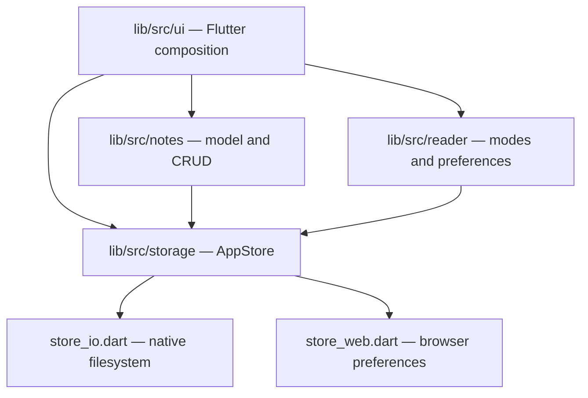

# Architecture



`notes` and `reader` are independent Dart capabilities. `ui` composes them. Native host runners generated via `flutter create` own the Android/iOS/macOS/Windows/Linux embedding. Plugins are explicitly limited to `path_provider`, `shared_preferences`, and `file_picker`.

## Native persistence

```text
abn-data/
  index.json
  notes/<id>.txt
  settings/reader.properties
  fonts/custom-<timestamp>.ttf|otf
```

`index.json` uses `formatVersion: 1`, `notes: [{id,createdAtEpochMillis,updatedAtEpochMillis}]`. Plain-text files are authoritative for content; missing/malformed metadata can be rebuilt. Unknown future index formats halt note operations. Index is written ahead of note changes, with best-effort index rollback after a file mutation failure. The temporary file rename is not a transactional filesystem and must be acceptance-tested on supported OSes. `reader.properties` retains format version 1, semantic sizes, default mode, orientation policy, colors and font references.

Native default data paths intentionally **do not overlap** the KMP application's path. macOS: `getApplicationSupportDirectory()/AnotherBoringNoteFlutter/abn-data`, resolved by `path_provider` into the macOS App Sandbox container (typically within `~/Library/Containers/<bundle-id>/Data/Library/Application Support/`). This is not the uncontained `$HOME/Library/Application Support` directory. For an isolated macOS dataset, set the **relative** `ABN_DATA_DIR=abn-flutter-smoke`: the folder is created under the same sandbox-scoped application-support path. Absolute overrides remain supported for explicitly authorized paths, but the macOS sandbox normally rejects paths such as `/tmp` without separate permissions. On Android/iOS the path is under the app support directory.

## Web preview

The browser adapter stores equivalent index/text/settings in browser-local `shared_preferences` keys, plus font bytes where possible. It cannot be treated as native `.txt` export or production persistence parity; no cloud sync or data migration is provided. Clearing site storage deletes browser-only data.

## Reader and platform effects

Flutter renders text directly and changes `TextStyle.fontSize` on zoom. Reader font family is resolved through built-in families or runtime-loaded TTF/OTF with fallback. Reader orientation is requested using `SystemChrome` on mobile; Presentation overrides to landscape. Actual gesture, lifecycle, orientation, accessibility and platform plugin behavior requires live acceptance.

## Compatibility boundaries

Original source is a Kotlin/Compose application; no binary interoperability exists. Native persisted **formats** are intentionally compatible, but installed app IDs and default data roots differ. Do not promise direct migration, old settings/font binary transfer, or production-platform parity without tests. Do not add a DB or server as an undocumented convenience.
